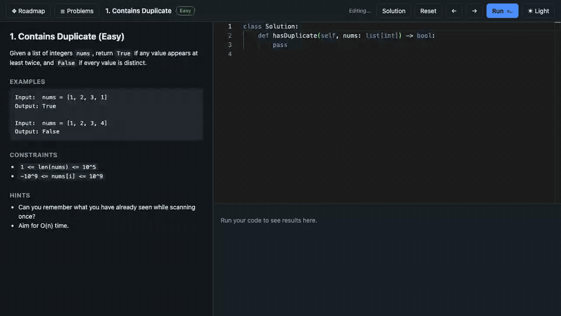

# offline-leet

Practice all 150 NeetCode problems in Python with no internet. Everything runs on your machine: a local web page with a code editor, or the command line and VS Code if you prefer.



## Quick start

You need Python 3.11 or newer. Nothing else has to be installed, and nothing is downloaded when you run it.

Double-click `Start.command` (or run `python3 -m leet serve`). Your browser opens `http://localhost:8765`.

- Pick a problem from the **Problems** list (it shows solved and attempted marks). Search by name or number (Enter opens the first match), filter by All, To do or Due, or use the button under the filters: it jumps to a due review if there is one, otherwise to the next unsolved problem.
- Read the statement on the left and write your solution in the editor on the right.
- Press **Run** or Cmd+Enter (Ctrl+Enter elsewhere). Failures show the input, the expected value, your output, any error, and anything you printed.
- Your code autosaves to the problem's `solution.py`.
- **Roadmap** (left of **Problems**) shows the NeetCode topic map: each topic is a node with a progress bar and a solved count, a dot when a review is due and a dashed ring around the topic you are in, and the lines show which topics lead to which. Click a topic to open a panel listing its problems, then click one to start it (the panel slides in, the card shrinks and its heatmap tucks away while it is open, and clicking the empty map slides it back out). A card in the top right shows solved counts per difficulty as a ring, with a shuffle button that opens a random unsolved problem and a trash button that deletes all progress (the old `progress.json` is backed up to `.leet-backups/` first, and your `solution.py` files are untouched). Under the rings, a heatmap shows your last 22 weeks (one square per day, darker for more runs; hover for the date, the runs and how many were correct), with your best streak above it, and the header shows your current streak of days with at least one run. The streak survives a day you have not practised yet, and days from before runs were counted show as one run each. The roadmap replaces the problem view while it is open, and the button turns into **Back to problem** to return to where you were.
- Drag the divider between the statement and the editor, or between the editor and the results, to resize them. Double-click a divider to reset it, or focus it and use the arrow keys (Home resets). Sizes are remembered in your browser.
- The panel under the editor has two tabs. **Test Case** is where you make your own cases, like on NeetCode: press **+** for a new case (it starts as a copy of the current one), then edit each argument as JSON in its own labelled box (`nums =`, `target =`). You do not type the expected answer, because the reference solution works it out. Cases autosave to `custom.json` beside the problem's `tests.json` (tracked by git like your solution) and never count towards solved, attempts or streaks. **Output** shows the result of the last run.
- Press **Run** and the official tests run along with your own cases. The Output tab opens with a plain verdict, **Correct**, **Wrong Answer**, **Runtime Error**, **Time Limit Exceeded** or **Memory Limit Exceeded**, and a count of passed test cases. Your own cases show a tick or cross on their tab in Test Case, with your output, the expected answer and anything you printed.
- **My notes** (under the statement) is a place for what tripped you up and the pattern to remember. It autosaves to `notes.md` beside the problem, shows a dot when there is something in it, and stays collapsed so you can review a problem without reading your own answer first.
- Stuck on a Medium or Hard problem? Open a hint under the statement. There are three hints per problem, each more revealing than the last, each in its own collapsed toggle so nothing is spoiled until you open it.
- On problems with hidden tests (see below), a run that passes the visible cases also runs a few big inputs. The problem only counts as solved when those pass too.
- Once every test passes (verdict **Correct**), the results show when the problem comes back for review, a **Next** button for the next unsolved problem, the target time and space complexity, and a **Compare with reference** button. The passed cases fold into one line you can open. Compare re-runs your solution and the reference on the biggest test inputs and tells you how your speed and memory compare (see "Performance check" below).
- Solved problems come back for review on a schedule (1, 3, 7, 14, then 30 days). Due ones show a ↻ in the list and `leet list` marks them `review`. Passing a review that is due moves it to the next interval, and failing one starts its schedule over. Running a problem again before it is due changes nothing. Problems you solved before this was added are due right away.
- On a phone the statement, editor and results become three tabs along the bottom, with **Run** beside them. Run jumps to the results, and Solution, Reset and the theme switch live under **More**. On the roadmap, pinch to zoom.
- **Reset** puts the starter code back (after asking). Your previous code is saved first in `.leet-backups/` (not tracked by git), so a reset can be undone by copying it back.
- **Solution** shows the reference solution, a short explanation of the approach and why it has that complexity, and its target complexity. If you have already solved the problem it opens straight away; otherwise it asks first, because it spoils the problem.

If macOS refuses to open `Start.command`, right-click it, choose Open, then Open again. Or run `python3 -m leet serve` in a terminal.

## Optional setup: the `leet` command and VS Code

The command line, pytest and the VS Code tasks use a virtual environment (needs internet once to install):

```bash
python3.12 -m venv .venv
.venv/bin/pip install -e '.[dev]'
```

```bash
.venv/bin/leet list                # problems and status (--todo, --category <name>, --hidden)
.venv/bin/leet next                # what to do now: a review that is due, else the next new problem (--new)
.venv/bin/leet start 3             # open the statement and solution.py in VS Code
.venv/bin/leet test                # test the current problem (or pass an id, slug or file path)
.venv/bin/leet reset               # restore the starter code (asks first; --yes to skip; your code is backed up)
.venv/bin/leet perf                # compare a passing solution's speed and memory with the reference
.venv/bin/leet serve               # start the web UI (--port, --no-open)
.venv/bin/leet validate            # check every reference solution against its tests
```

`leet start` needs the `code` command on your PATH (in VS Code: Shell Command: Install 'code' command in PATH).

In VS Code, open a `solution.py` and run the task **Leet: test current file** (Terminal > Run Task). Every test case also shows in the Testing panel. VS Code will underline `Optional`, `ListNode` and similar names in the starter code as undefined, because they are provided when the tests run (see below). It does not affect running.

There is also a Dev Container (`.devcontainer/`) if you want a pinned Python and your code isolated from the rest of your machine.

## The problems

All 150 NeetCode problems, in roadmap order, in 18 categories from Arrays & Hashing to Bit Manipulation:

```
problems/<category>/<id>-<slug>/
  README.md      the statement
  solution.py    your code (starter code to begin with)
  starter.py     the original starter code, used by Reset
  tests.json     test cases
  custom.json    your own test cases (only once you add one)
  notes.md       your own notes (only once you write one)
  meta.json      title, difficulty, method name, how to compare results
reference/       reference solutions (spoilers!)
```

The starter code follows NeetCode's conventions. `ListNode`, `TreeNode`, `Node`, `Interval` and the typing names (`Optional`, `List`, `Dict`, ...) are already defined, so you do not import them. Each stub shows the class definition in a comment, as NeetCode does.

Other notes:

- Statements and tests are original, not copied from LeetCode. Some examples use the same well-known inputs.
- The 122 Medium and Hard problems have three tiered hints (`hints.json`). In the web UI they sit in collapsed toggles under the statement. In the problem's `README.md` they sit in a collapsed "Hints" section at the bottom (open it in VS Code's Markdown preview or on GitHub), so the statement itself stays spoiler-free. Easy problems keep a short, always-visible Hints section.
- Each problem has hand-written cases plus larger generated ones. Where several answers are valid (Course Schedule II, Alien Dictionary, Gas Station and others), a checker verifies the answer instead of comparing to one exact value.
- Design problems (LRU Cache, Twitter, Trie and others) are tested with a sequence of method calls and their expected results.
- Each case has a time limit of 5 seconds, and a run stops at the first timeout.
- `solution.py` files are tracked by git, so your solutions are committed along with everything else.

## Hidden tests

Some problems (58 so far, listed by `leet list --hidden`) also have hidden tests: a few inputs with up to 100,000 elements, grid cells, nodes, edges or calls (or, for Pow(x, n), huge exponents), built when you run, not stored in the repo. They run only after every visible case passes. A solution that is too slow (for example O(n^2)) times out on them, and a failure shows the case number and the size of the input, not the input itself. Those problems' statements allow up to 10^5 elements to match.

Only problems where a slower approach can plausibly pass the stored cases have them. Problems whose input size is capped by the problem itself (Backtracking, the 2-D and most 1-D DP problems) are not covered, nor are ones where every sensible approach is linear or where the only slower alternative is a plain scan that stays fast at 10^5 elements (Binary Search, Trees, most Bit Manipulation and Math & Geometry).

- The first run of a problem builds its hidden inputs (a second or two) and caches them in `.leet-cache/` (not tracked by git, up to about 200 MB for all of them).
- `leet test` and the web UI treat a hidden failure like any other failure: the problem stays "attempted".
- `leet validate` runs the reference solutions against the hidden tests too, so a reference that is too slow is caught.
- Recursion is capped at depth 10,000, so a recursive solution that goes one call per element can hit a recursion error on a 100,000-element input. Use a loop or an explicit stack for those.

## Performance check

`leet perf` (or the button in the web UI) answers "is my solution in the right ballpark?" without internet or any model. It first checks that your solution passes every test, then takes the three test inputs the reference solution finds heaviest and measures both solutions on them:

- **Time:** the best of several runs of just your function call (inputs are prepared beforehand, garbage collection is paused).
- **Memory:** the peak extra memory allocated during the call, measured with `tracemalloc`. The input itself is not counted, and Python's call stack depth is not included.

You get a verdict ("About as fast as the reference", "Much slower ... usually means a worse time complexity", and so on), the ratio, a per-input table, and the target complexity for the problem (for example `O(n)` time, `O(1)` space).

This is an estimate, not a proof, and it cannot tell you your exact Big-O:

- It only says how you compare with the reference on this machine, on these inputs. A ratio above roughly 8x usually means a worse complexity class, and a ratio near 1x means a similar one.
- If the inputs are small or the worst case for your approach is not in the tests, a slow solution can look fine. Inputs top out around 10,000 elements (the hidden tests are not used for this).
- Tiny inputs run too fast to time reliably, so some Easy problems report "too fast to compare".
- Timings vary a little from run to run.

## Limitations

- The stored test cases have at most about 10,000 elements, to keep the repo small. Only the problems with hidden tests (above) are checked on bigger inputs, so on the others a slow solution (for example O(n^2)) can still pass on a fast machine.
- Your code runs as a normal process on your machine, with no sandbox. A watchdog stops it if it uses more than 1 GB of memory (the case fails with "memory limit exceeded"), but that is a safety net against runaway code, not isolation. Use the Dev Container if that matters to you.
- Timeouts rely on Unix signals, so macOS and Linux work but Windows does not.
- Hints and the performance check are fixed rules and measurements, so they cannot explain why your code is slow or react to what you wrote. There is also no timer yet.

## Regenerating problems (for contributors)

Problems are defined in `tools/specs/*.py`. Each defines the statement, starter code, a reference solution, hand-written cases, a generator for larger cases, and optionally a brute-force solution.

```bash
.venv/bin/python tools/build.py                 # build every category (never overwrites your solution.py)
.venv/bin/python tools/build.py trees stack     # build specific categories
.venv/bin/python tools/timing.py                # see which brute-force solutions time out on the big cases
.venv/bin/python tools/hintlib.py               # re-apply hints and list Medium/Hard problems without any
```

Hints live in `tools/hints/<category>.py` as `{problem_id: [hint1, hint2, hint3]}`, and target complexities live in `tools/complexity_data/<category>.py` as `{problem_id: (time, space)}`. Hidden tests live in `tools/hidden_data/<category>.py` as `{problem_id: (constraint_edits, source)}`, where `source` is the problem's `hidden.py` (a `generate(rng)` function returning argument lists) and `constraint_edits` raises the README's size limits to match. `build.py` re-applies both after every build (`tools/complexity.py` lists any problem without a target). Problems 1 to 5 predate the build pipeline; `tools/extend_basic_cases.py` adds their large test cases.

Run the repo's own tests with `.venv/bin/pytest`. `tests/test_solutions.py`, which runs your `solution.py` files and fails until you have solved everything, is left out unless you pass `--solutions` (VS Code and the Dev Container already do, so each case shows in the Testing panel): `.venv/bin/pytest --solutions -k two-sum`.

`build.py` checks each reference solution against the hand-written cases, generates the larger cases, and cross-checks the reference against the brute-force solution on random small inputs. The build stops at the first problem that fails a check.

See [SPEC.md](SPEC.md) for the design notes.
